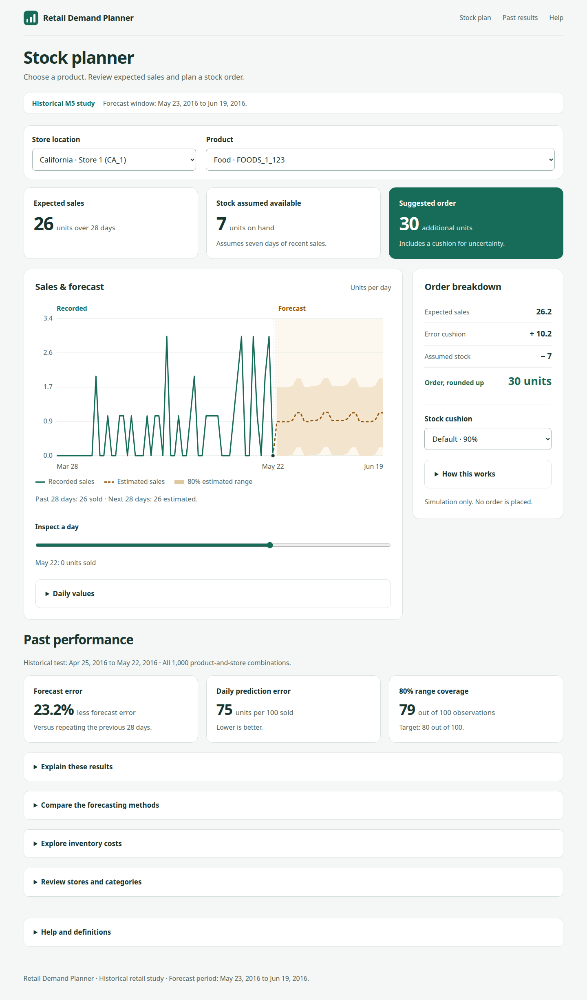

# Retail Demand Planner

Forecast retail sales, compare forecasting methods, and explore inventory decisions using Python, LightGBM, SQLite, and FastAPI.

The project asks: **Which stores and products need closer stock review, and how much might they need for the next 28 days?** It includes a reproducible forecasting workflow, an interactive dashboard, seven SQL analyses, and a documented study of 1,000 item-store histories from the public M5 dataset.

**Headline result:** LightGBM reduced holdout subset-hierarchy WRMSSE by **23.2%** versus the 28-day seasonal baseline. Calibrated 80%/90% intervals achieved **79.2%/89.7%** coverage, and the transparent inventory simulation reduced estimated cost by **9.2%**.



[Watch the 2-minute captioned dashboard walkthrough](docs/assets/dashboard-demo.webm) · [Read the narration script](docs/demo-script.md)

Start with the [case study](reports/portfolio/case_study.md) to review the findings without installing anything. The [portfolio folder](reports/portfolio/) contains the shareable exports and audit manifest. Raw data and generated reports stay local.

## Quick start

You need Python 3.10 or newer and [uv](https://docs.astral.sh/uv/getting-started/installation/).

```bash
uv sync --locked --all-extras
uv run retail-planner demo --ml --output-dir reports/demo
uv run retail-planner serve --output-dir reports/demo
```

Open <http://127.0.0.1:8000/>. The demonstration creates a synthetic dataset, compares forecasting methods, and writes the dashboard, forecasts, model, and evaluation artifacts to `reports/demo/`.

To create and inspect the SQL analysis in another terminal:

```bash
uv run retail-planner analyze --output-dir reports/demo --analysis-dir reports/demo-analysis
uv run python scripts/run_query.py store_performance --database reports/demo/analysis.sqlite --limit 5
uv run retail-planner monitor --output-dir reports/demo
```

## Run the real M5 study

1. Download `sales_train_evaluation.csv`, `calendar.csv`, and `sell_prices.csv` from the [M5 data archive](https://zenodo.org/records/10203108).
2. Put the files directly in `data/raw/m5/`.
3. Run:

```bash
uv run retail-planner run --ml --data-dir data/raw/m5 --limit-series 1000 --output-dir reports/latest
uv run retail-planner analyze --output-dir reports/latest --analysis-dir reports/analysis
uv run retail-planner serve --output-dir reports/latest
```

The input directory must contain:

```text
data/raw/m5/
├── calendar.csv
├── sales_train_evaluation.csv
└── sell_prices.csv
```

Training the real study takes more time and memory than the synthetic demonstration. The `--limit-series 1000` option uses a deterministic sample. Omit `--ml` to compare only the six simple and statistical forecasting methods.

Reproducible profiles are included for the published sample and a resource-intensive full-series experiment:

```bash
make sample  # 1,000 series, 3 folds, 10 pre-validation Optuna trials
make full    # all series, 5 folds, 40 trials; requires substantial RAM and runtime
```

The full profile is an executable experiment definition, not a claim that the committed metrics are official full-M5 results.

## Published study

The portfolio study covers 1,000 item-store histories across 1,941 days, using three historical validation periods and a separate final 28-day holdout.

| Forecasting method | Holdout subset hierarchy WRMSSE ↓ |
|---|---:|
| LightGBM | 0.759 |
| Weekday blend | 0.785 |
| 28-day seasonal baseline | 0.988 |

LightGBM produced 23.2% lower forecast error than the 28-day seasonal baseline and about 3.4% lower error than the weekday blend. Its holdout WAPE was 74.7%, so substantial forecasting error remains.

The one-order inventory simulation produced a cost of 29,045 versus 31,995 arbitrary units, about 9.2% lower. This is a hypothetical scenario, not measured business savings. See the [case study](reports/portfolio/case_study.md) for segment findings and limitations.

## Workflow

1. Load sales, calendar, and price data from the three M5 tables.
2. Compare six baselines and, when requested, a global LightGBM model over expanding-window validation folds.
3. Select the method with the lowest mean validation subset hierarchy WRMSSE.
4. Calibrate forecast intervals and inventory cushions from validation residuals.
5. Evaluate the selected method on the separate final 28 days.
6. Forecast the next 28 days and save results, provenance, and the HTML report.
7. Optionally export the SQL analysis or serve the report through FastAPI.

Sales-derived features stop before each forecast date. Known calendar events may be used in advance. Training only occurs through the `run` or `demo` command; the API reads saved results.

```mermaid
flowchart LR
    A[M5 sales, calendar, prices] --> B[Deterministic ingestion]
    B --> C[Causal lag, rolling, price, calendar features]
    C --> D[Expanding-window validation]
    D --> E[Baselines + tuned LightGBM]
    E --> F[Hierarchy, WAPE, bias, pinball, coverage]
    F --> G[Inventory simulation]
    G --> H[Dashboard + FastAPI + SQL exports]
    H --> I[Monitoring checks]
```



## Repository structure

```text
retail-demand-planner/
├── .github/workflows/ci.yml   # Distribution, test, and workflow validation
├── data/                      # Data setup notes; raw CSVs stay local
├── configs/                   # Sample and full-series experiment profiles
├── docs/                      # Architecture, usage, method, and guides
├── notebooks/                 # EDA and frozen-result model analysis
├── reports/portfolio/         # Shareable published-study snapshot
├── scripts/run_query.py       # Read-only SQLite query runner
├── src/retail_planner/        # Application package
├── tests/                     # Unit and integration checks
├── CONTRIBUTING.md
├── Dockerfile
├── pyproject.toml
└── uv.lock
```

## Documentation

| Guide | Purpose |
|---|---|
| [Usage and troubleshooting](docs/usage.md) | Commands, HTTP endpoints, pip, and Docker |
| [Architecture](docs/architecture.md) | Module responsibilities and data flow |
| [Data](docs/data.md) | Inputs, fields, and sampling |
| [Methodology](docs/methodology.md) | Validation, metrics, intervals, and inventory assumptions |
| [Analyst guide](docs/analyst-guide.md) | SQL model, queries, and spreadsheet exercises |
| [Five-minute demonstration](docs/demo.md) | Presentation walkthrough |
| [Interview preparation](docs/interview-prep.md) | Results and limitations |
| [Demo recording script](docs/demo-script.md) | Reproduce or narrate the captioned walkthrough |
| [Contributing](CONTRIBUTING.md) | Development and validation |

## Experiment evidence and what failed

- Last-value, 7-day seasonal, 28-day seasonal, moving-average, Croston, and weekday-blend baselines are evaluated before LightGBM.
- The 28-day seasonal baseline is the published benchmark gate. LightGBM improved mean validation WRMSSE by **21.3%**, with improvements in all three folds.
- The stronger handcrafted weekday blend was harder to beat: LightGBM improved mean validation WRMSSE by only **3.4%**. This negative result is retained because it shows that model complexity added modest value beyond a domain-aware baseline.
- A fixed LightGBM configuration produced the published snapshot. New runs can use pre-validation Optuna tuning and early stopping with `--tune-trials`; the frozen holdout remains unavailable to tuning.
- Prediction intervals use validation-residual conformal calibration rather than pretending symmetric model errors are direct quantile forecasts. Coverage and pinball loss are recorded for the selected and seasonal methods.
- The 1,000-series study is intentionally labeled a subset. Use `configs/full.json` to attempt the full-series profile on suitable hardware; never present subset WRMSSE as an official leaderboard score.

## Scope and limitations

- Results describe a sampled historical study, not an official full-M5 competition score or live deployment.
- Zero sales can reflect low demand or unavailable stock; the dataset cannot distinguish them.
- Inventory calculations assume immediate delivery, one order, and seven days of starting stock.
- Cost controls change the retrospective simulation; they do not change the order rule.
- New runs record input hashes, selected-series fingerprints, configuration, and package versions in `run_manifest.json`.

This is a portfolio and research project. Operational ordering would require live inventory and lead-time data, production validation, access controls, deployment infrastructure, and ongoing monitoring.
