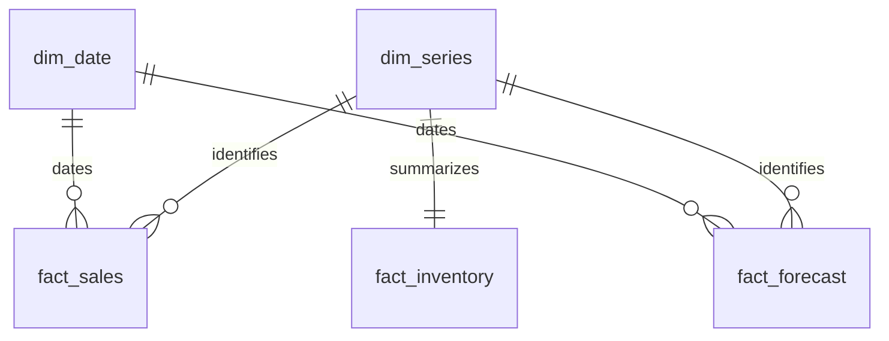

# SQL and spreadsheet walkthrough

Start with [the case study](../reports/portfolio/case_study.md). The CSVs beside it can be read immediately without installing Python or downloading the raw dataset.

## Rebuild the analysis

From the project folder, using the existing saved report:

```bash
uv run retail-planner analyze
uv run python scripts/run_query.py store_performance
```

This creates `reports/latest/analysis.sqlite`, seven CSVs in `reports/analysis/`, a case study, and a checksum manifest. It does not retrain the model. The checked-in `reports/portfolio/` is the published snapshot; local analysis does not replace it by default.

For a fresh checkout without the raw data or report, build a separate synthetic example:

```bash
uv sync --locked --all-extras
uv run retail-planner demo --output-dir reports/demo
uv run retail-planner analyze --output-dir reports/demo --analysis-dir reports/demo-analysis
uv run python scripts/run_query.py store_performance --database reports/demo/analysis.sqlite
```

Synthetic outputs check the workflow. They do not reproduce the published M5 findings. To reproduce the real-data study, follow the data instructions in the README, use the locked environment, and run the 1,000-series study before `analyze`.

## Data model



| Table | One row represents | Important fields |
|---|---|---|
| `dim_series` | One item at one store | `series_id`, `item_id`, `store_id`, `category` |
| `dim_date` | One calendar date | `sales_date`, `weekday` (Monday=0), `week_start`, `period` |
| `fact_sales` | Observed units for one series on one day | `series_id`, `sales_date`, `units` |
| `fact_forecast` | One forecast view for one series on one day | `forecast_kind`, `method`, `period`, `units`, interval bounds |
| `fact_inventory` | One series under the saved default order scenario | Future order, assumed stock, historical simulated costs |
| `model_evaluation` | One forecasting candidate | Validation score, holdout score, selection flag |

The mart contains **56 observed days** per series and **28 future dates**. The last 28 observed days are the holdout. Forecasts have two views: `selected` and `seasonal_28`. Even when the selected method is the seasonal baseline, these remain separate comparison views. A join must filter `forecast_kind` and align both series and date; otherwise observed sales are duplicated.

The original model study uses the full historical series. The mart is a smaller analysis extract. Its future dates follow the historical dataset cutoff in 2016; they are not forecasts for the present day.

## Questions answered with SQL

| Business question | Query / CSV | SQL skills |
|---|---|---|
| Which stores need investigation? | [store_performance.sql](../src/retail_planner/analysis/sql/store_performance.sql) | Joins, grouped ratios, `NULLIF` |
| Does the model improve every category? | [category_performance.sql](../src/retail_planner/analysis/sql/category_performance.sql) | Multiple fact joins, baseline comparison |
| How did complete weeks change? | [weekly_demand.sql](../src/retail_planner/analysis/sql/weekly_demand.sql) | CTEs, `HAVING`, `LAG`, partitioning |
| How do weekday sales differ? | [weekday_demand.sql](../src/retail_planner/analysis/sql/weekday_demand.sql) | Conditional aggregation, means |
| Which model won on validation? | [model_comparison.sql](../src/retail_planner/analysis/sql/model_comparison.sql) | `DENSE_RANK`, selection discipline |
| Which items contributed large errors? | [error_review.sql](../src/retail_planner/analysis/sql/error_review.sql) | Aggregation, signed and absolute errors |
| Where does the order simulation help? | [inventory_review.sql](../src/retail_planner/analysis/sql/inventory_review.sql) | Calculated measures, prioritization |

Run any query by its filename without `.sql`, for example:

```bash
uv run python scripts/run_query.py category_performance
uv run python scripts/run_query.py weekly_demand --limit 10
```

## KPI definitions

- **Actual units:** sum of observed sales in the selected period.
- **WAPE:** sum of absolute daily errors divided by sum of actual units. Smaller is better. SQL returns NULL when actual demand is zero; the CSV cell is blank. WAPE can exceed 100%.
- **Bias:** sum of forecast minus actual units, divided by actual units. Positive means overforecasting; negative means underforecasting.
- **Week-over-week change:** `(this week - previous week) / previous week`. Only complete seven-day weeks are compared. The first week and a zero-demand previous week have no defined percentage.
- **Simulated cost reduction:** baseline historical simulated cost minus selected-method historical simulated cost. Positive favors the selected method under the stated assumptions.
- **WRMSSE:** the model-selection score accounts for demand scale and a hierarchy. Its subset implementation is documented in [methodology.md](methodology.md); it is different from WAPE and the official full-M5 score.

Do not average store or item WAPEs to produce the overall WAPE. Calculate the ratio of sums, or weight group WAPE by actual units.

## Excel exercise

Import `store_performance.csv` and `inventory_review.csv` as tables named `StorePerformance` and `InventoryReview`. Format WAPE, bias, and change columns as percentages; their stored values are decimal ratios.

Use these formulas in a summary sheet:

```text
Total holdout units:
=SUM(StorePerformance[actual_units])

Overall holdout WAPE:
=SUMPRODUCT(StorePerformance[actual_units],StorePerformance[wape])/SUM(StorePerformance[actual_units])

Historical simulated cost reduction:
=SUM(InventoryReview[holdout_baseline_cost])-SUM(InventoryReview[holdout_selected_cost])
```

Create a horizontal bar chart of store WAPE and a category chart comparing selected versus baseline WAPE. Use `weekly_demand.csv` for a store-filtered weekly trend. Explain the finding before describing the chart.

These are reproducible spreadsheet exercises, not a claim that a Power BI report or an Excel workbook has already been built. If you build one, retain the CSV scope and KPI definitions above. Aggregated CSVs are separate summary views; joining them at incompatible grains can inflate totals.

## Data quality decisions

The export rejects duplicate series IDs, non-finite or negative values, wrong array sizes, misaligned dates, mismatched holdout actuals, and invalid interval bounds. SQLite primary keys and foreign keys protect the joins. The exported report includes full-history price coverage and zero-sales share in `summary.json`.

The original CSV loader treats empty sales cells as zero and missing prices as unavailable. A series with no usable recent prices receives volume-based score weights. These are explicit implementation assumptions, not proof that missing values mean no demand. The export checks do not audit every raw M5 row or validate the source's business records.

## Practice without looking at the supplied query

1. Find the three stores with the most negative bias. Explain why this differs from ranking WAPE.
2. Find categories where selected WAPE is smaller than baseline WAPE. Return the percentage-point difference.
3. Find the two highest-error items within each store using `ROW_NUMBER()`.
4. Calculate each store's share of total holdout demand using a window sum.
5. Explain why joining sales to forecasts on series ID alone creates a many-to-many result.
6. Show how you would investigate a store with high error without claiming that the data proves stockouts.
