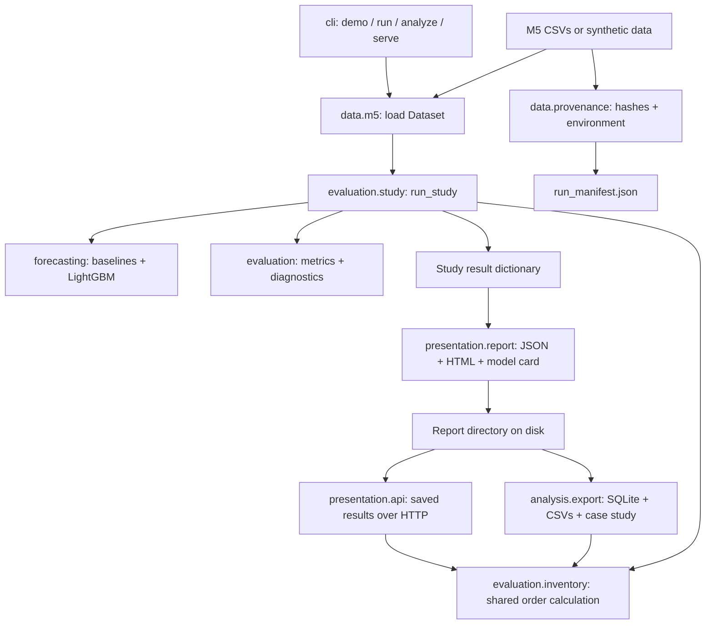

# Code architecture

The package has five modules organized by responsibility. `cli.py` connects them into four user-facing commands. Each module owns its implementation and exposes a small set of functions to callers.

## Data flow



`analyze` and `serve` start from a saved report. They do not invoke model training. HTML reports embed their data and can also be opened directly in a browser.

## Module responsibilities

| Module | Owns | Main interface | Dependencies within this project |
|---|---|---|---|
| `data` | M5 records, CSV loading, deterministic sampling, demo inputs, hashes, environment metadata | `load_m5`, `write_demo`, `write_run_manifest` | None |
| `forecasting` | Baselines, LightGBM features, fitting, prediction, persistence | `forecast`, `ModelConfig`, `train_lightgbm`, `predict_lightgbm`, `save_model` | `data.m5` |
| `evaluation` | Rolling validation, selection, holdout scoring, interval calibration, diagnostics, inventory | `run_study`, `score_hierarchy`, `order_scenario` | `data.m5`, `forecasting` |
| `analysis` | Result validation, SQLite schema and population, SQL queries, CSVs, case study | `build_analytics`, `validate_result` | `data.provenance`, `evaluation.inventory` |
| `presentation` | Report files, HTML template, FastAPI routes, request validation | `write_report`, `create_app` | `evaluation.inventory` for HTTP scenarios |

`cli.py` owns argument parsing, output locations, and the order in which these interfaces are called. Numerical code does not depend on the CLI, HTML, or FastAPI.

The shared inventory calculation lives in `evaluation/inventory.py`. The study, SQL export, and HTTP scenario use the same implementation, so changing the order formula has one home. Reading a saved report does not require importing the study orchestrator.

## Source layout

```text
src/retail_planner/
├── __init__.py
├── cli.py
├── data/
│   ├── __init__.py
│   ├── m5.py                  # Data records, loading, and demo inputs
│   └── provenance.py          # Checksums and run metadata
├── forecasting/
│   ├── __init__.py
│   ├── baselines.py           # Last value, seasonal repeats, weekday blend
│   └── lightgbm.py            # Features, training, prediction, persistence
├── evaluation/
│   ├── __init__.py
│   ├── diagnostics.py         # Data profile and segment monitoring
│   ├── inventory.py           # One-order scenario and aggregate evaluation
│   ├── metrics.py             # Subset hierarchy WRMSSE, WAPE, bias, quantiles
│   └── study.py               # Validation, selection, holdout, future forecast
├── analysis/
│   ├── __init__.py
│   ├── export.py              # Validation, SQLite, CSVs, case study, manifest
│   └── sql/                   # Seven packaged, named analysis queries
└── presentation/
    ├── __init__.py
    ├── api.py                 # Optional HTTP access to saved report data
    ├── report.py              # JSON, HTML, monitoring, and model card writer
    └── templates/
        └── dashboard.html     # Self-contained dashboard template
```

Keep SQL beside its analysis implementation and the HTML template beside its report writer. Both are declared as package data in `pyproject.toml`, so an installed distribution can generate reports and execute queries.

## Interfaces and contracts

### Load data

`load_m5(directory: Path, limit_series: int | None) -> Dataset`

The directory must contain the three documented CSVs. The loader aligns daily sales with calendar rows, reads prices for selected series, and uses a fixed-seed reservoir sample when a limit is supplied. It raises `FileNotFoundError` for missing inputs and `ValueError` for insufficient history or missing calendar days.

`Dataset`, `Series`, and `CalendarDay` are frozen data records. Their tuples carry ordered history; callers must preserve date and series alignment. See [data notes](data.md) for source fields.

### Run the study

`run_study(dataset, folds=3, include_ml=False, model_config=None, artifact_dir=None) -> dict`

This interface owns validation, selection, calibration, final holdout, and future forecasting. Sales features and training targets must remain before each forecast origin. The final 28 days must not affect model selection or residual calibration. The result dictionary is the shared report format.

The calculation returns results in memory. With ML enabled and an artifact directory supplied, it also saves the final fitted model and its metadata. LightGBM and NumPy are imported when the ML implementation is used. Runtime and memory scale with series count, training windows, and horizon rows.

### Persist and consume results

- `write_report(result, directory)` creates `results.json`, `index.html`, `monitoring.json`, and `model_card.md`. It replaces those files in the target directory.
- `write_run_manifest(data_dir, output_dir, options)` records input hashes, the selected-series fingerprint, run options, and the observed environment.
- `build_analytics(report_dir, output_dir)` validates the saved result, creates `report_dir/analysis.sqlite`, and exports the analysis pack to `output_dir`. It returns the export manifest and raises `ValueError` for invalid records. A missing results file raises `FileNotFoundError`.
- `create_app(report_dir)` loads saved results once and returns a FastAPI application. The report must already exist. Restart the server after regenerating its source report.

The CLI handles missing analysis reports as actionable command errors. HTTP request validation rejects invalid scenario values; an unknown series returns HTTP 404.

## Working directories and artifacts

Paths passed to the CLI are relative to the terminal's working directory. Run documented commands from the repository root or pass absolute paths.

| Location | Purpose | Version control |
|---|---|---|
| `data/raw/m5/` | Downloaded source CSVs | Ignored |
| `reports/latest/` | Locally generated real-data study | Ignored |
| `reports/analysis/` | Default local SQL exports | Ignored |
| `reports/demo/`, `reports/demo-analysis/` | Synthetic workflow artifacts | Ignored |
| `reports/portfolio/` | Published M5 study snapshot | Included |
| `src/`, `tests/`, `docs/`, `scripts/` | Code, verification, and instructions | Included |

The published portfolio remains separate from default generated outputs. Its original training environment is unavailable; its export manifest must not be presented as a training-run manifest.

## Where to make a change

| Change | Start here | Relevant checks |
|---|---|---|
| Input fields, alignment, sampling | `data/m5.py` | `tests/test_study.py`, `tests/test_full_project.py` |
| Baseline or ML features | `forecasting/` | Leakage and saved-model parity checks |
| Validation, metric, interval, inventory rule | `evaluation/` | Study, SQL reconciliation, and scenario checks |
| SQL measure or export | `analysis/export.py`, `analysis/sql/` | `tests/test_analytics.py`, CLI query workflow |
| Dashboard or report files | `presentation/report.py`, `presentation/templates/` | Report generation and manual dashboard inspection |
| HTTP route or scenario input | `presentation/api.py` | API workflow and request validation checks |
| CLI option or default path | `cli.py` | `tests/test_cli.py` and usage documentation |

Internal Python import paths changed when the package was organized into these modules. The `retail-planner` executable and its four commands remain the user-facing entry point. The default `analyze` destination is now `reports/analysis/`; explicitly choose `reports/portfolio/` only when intentionally refreshing the published snapshot.
